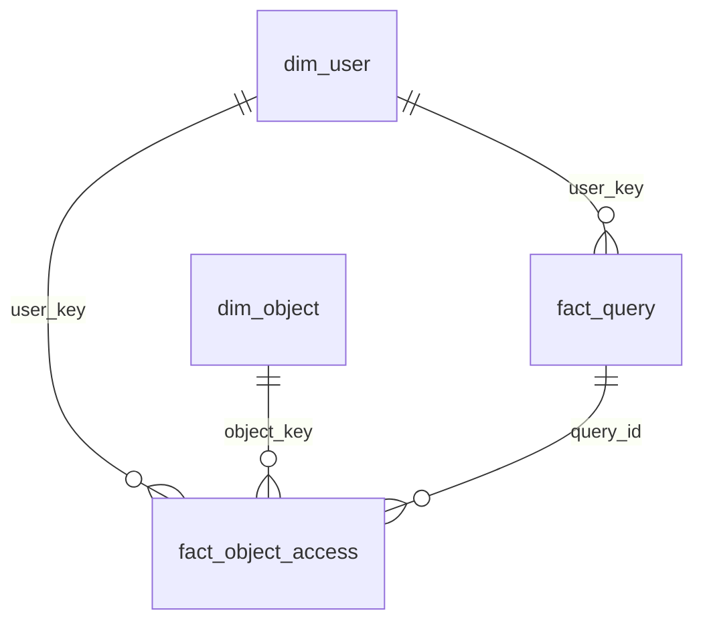

# trino-usage-meta-dwh

A small meta data warehouse that shows how the Iceberg tables behind a Trino cluster are used. It answers two questions, for any period and with history:

- **A:** How many distinct users queried table X?
- **B:** How many resources did team Y consume?

The raw input is Trino's `queryCompleted` events. Everything runs locally in Docker (Trino, an Iceberg REST catalog, an S3-compatible store), with synthetic test data.

## How to run

You need Docker and [uv](https://docs.astral.sh/uv/). Trino needs a few GB of memory.

```bash
docker compose up -d                          # Trino, Iceberg REST catalog, RustFS as local S3 stand-in (give Trino ~20 s)
uv run run.py --init                          # create schemas and tables (idempotent)
uv run generator/generate.py                  # simulate the event listener and the two metadata exports
uv run run.py 2026-10-12 2026-10-22           # load all days, this is also the backfill
```

Run a query:

```bash
docker compose exec -T trino trino < sql/queries/a_distinct_users_per_table.sql
```

Or connect a SQL client to `localhost:8080`, catalog `iceberg`, any user name, no password.

One event ends only after the run for its day. To see the lookback fix it:

```bash
uv run generator/generate.py --late           # the long query that ends on Thu 02:30 arrives
uv run run.py 2026-10-21 2026-10-22           # the daily run: yesterday and the day before
```

Check everything end to end (expected results, the late event, idempotency; recreates core and mart):

```bash
uv run tests/check.py
```

Start over with `docker compose down -v`.

## Model

```
Raw (kept for a limited time, e.g. 90 days)
  raw.query_events   raw.team_snapshot   raw.object_snapshot
        │
Core (kept forever)
  dim_user (SCD 2)             dim_object (lifecycle)
  fact_query                   fact_object_access
        │
Mart (daily aggregates)
  agg_user_resources_daily     → question B
  agg_object_user_daily        → question A
```

| Table | Grain (one row per …) | Notes |
|---|---|---|
| `raw.query_events` | query event | as delivered, includes the full SQL text |
| `raw.team_snapshot` | user × day | export of the user → team mapping |
| `raw.object_snapshot` | table or view × day | export of `information_schema.tables` |
| `core.dim_user` | user version | SCD 2 on the team, type 1 on team name and account type |
| `core.dim_object` | table, view | lifecycle: `first_seen`, `deleted_at`, `in_directory` |
| `core.fact_query` | query | all resource metrics live here |
| `core.fact_object_access` | query × object × access type × directness | one row per table read, per view read and per write |
| `mart.agg_user_resources_daily` | day × user version | sums, plus the maximum of the peak memory |
| `mart.agg_object_user_daily` | day × object × user version × access type × directness | keeps the user, so distinct counts stay exact |



## Example results

On the sample data (Oct 12 to Oct 22, [`sql/queries/`](sql/queries)), after the late event from the last step above has arrived. Before it, A shows 18 queries and Product Analytics shows 14 queries and 1.606 CPU hours.

**A**: `a_distinct_users_per_table.sql`, table `ide_events`:

| distinct_users | human_users | queries |
|---|---|---|
| 7 | 4 | 19 |

**B**: `b_resources_per_team.sql`:

| team_name | queries | cpu_hours | memory_gb_hours | data_read_gb | largest_query_peak_memory_gb |
|---|---|---|---|---|---|
| Product Analytics | 15 | 1.856 | 44.028 | 52.501 | 60.0 |
| Platform | 10 | 0.279 | 0.201 | 19.18 | 3.0 |
| BI | 4 | 0.021 | 0.003 | 1.9 | 1.0 |
| Unknown | 3 | 0.011 | 0.003 | 0.89 | 1.0 |

The other queries: usage and resource trends per week, unused tables, tables that are written but never read, and how often each column is read.

## Design decisions

**Two fact tables.** A query has one CPU value but touches many tables. Resources belong to the query, usage belongs to the access, so each lives at its own grain and nothing is counted twice. Question B only reads `fact_query`, question A only `fact_object_access`.

**No resource split across tables.** CPU and memory are not divided between the tables of a query. Any split (for example by bytes read) would be an estimate that joins, aggregations and compression can distort, and people could optimise the wrong table. Per table, only the bytes Trino measured are stored.

**Resource metrics.**

| Metric | Use | Why |
|---|---|---|
| `cpu_time_ms` | consumption | how much compute the query took from the cluster, additive |
| `cumulative_memory` | consumption | memory × time, additive, unlike the peak |
| `physical_input_bytes` | consumption | bytes actually read from S3, this is what costs money |
| `peak_user_memory_bytes` | outliers | not additive (two 2 GB queries at different times never held 4 GB), but the maximum can be combined over any period |
| `queued_time_ms` | cluster load | not the team's consumption, waiting is mostly caused by others |

**Team history ("as was").** `dim_user` is SCD 2 on the team: a query belongs to the team its user was in when it ran. The team is an attribute of `dim_user` (no separate team table), and a query gets the `user_key` of the version valid on its day.

**Distinct users by login, never by key.** A user with a team change has two `user_key`s, so a distinct count over `user_key` counts them twice. On the sample data, `ide_events` gives 7 users by login and 8 by key.

**Keep the user in the usage aggregate.** A distinct count per day cannot be summed to a week or month. `agg_object_user_daily` keeps one row per user and day, so any period stays exact, and it is still much smaller than the fact because repeated queries of one user on one day collapse into one row.

**Store first, decide in the query.** Query status and error category, read versus write, direct versus indirect access through a view, and account type are stored as columns. Queries decide what counts. Raw data is deleted after its retention time, so what the core layer drops is gone for good.

**Small attributes live in the fact.** Status, error category and source have a handful of values, no further attributes and compress to almost nothing with Parquet's dictionary encoding. Separate dimension tables would only add joins. For the same reason there is no date dimension, `query_date` is a column and the partition key.

## Loading and updating

The load runs once a day, in this order:

```
raw.team_snapshot ───► dim_user ──┐
                                  ├─► fact_query ───────────► agg_user_resources_daily
raw.query_events ─► dim_object ───┤
raw.object_snapshot ► dim_object ─┴─► fact_object_access ──► agg_object_user_daily
```

- **Facts and aggregates:** the partition of the day is replaced (delete, then insert), so any run can be repeated.
- **Dimensions:** `MERGE`. They carry state over time, so they cannot be replaced per day.
- **Lookback:** every daily run recomputes yesterday and the day before. A query belongs to the day of its `createTime`, but its event only exists once the query ends, so long queries over midnight or a delayed event pipeline would otherwise be missing from their day for good.
- **Backfill:** the same job over a date range, `uv run run.py <from> <to>`. Possible as far back as the raw data is kept.

## Additional metadata

The query events do not contain teams, and they never show a table nobody queries. The DWH needs two more inputs, each delivered as a daily full snapshot:

| Export | Columns | Used for |
|---|---|---|
| user → team (for example from LDAP or the HR system) | `snapshot_date`, `user_login`, `team_id`, `team_name`, `account_type` (`human` or `service`), optional `changed_at` | team history, `dim_user`, separating service accounts |
| table directory (`information_schema.tables` over Trino) | `snapshot_date`, `table_catalog`, `table_schema`, `table_name`, `table_type` | unused tables, `first_seen` and `deleted_at` |

The DWH builds the history itself by comparing snapshots. A change shows up when it is noticed, so it can be a day late.

## Assumptions

- **Time:** days are UTC days of `createTime`. A query that runs over midnight counts fully for the day it started.
- **Retention:** raw events are kept for a limited time (for example 90 days). The core layer holds the history from then on.
- **User → team:** every user has exactly one primary team at any time. Teams are identified by `team_id`, the name can change. A rename is a type 1 change: the newest name applies to all versions.
- **Unknown users:** a login that queried but is in no team snapshot gets its own `dim_user` row with team `Unknown` (id `-1`) and account type `unknown`. If it shows up in the team export later, it gets a new version with the real team, the past stays with `Unknown`, and the account type is corrected on all versions.
- **Service accounts** are users like any other, with `account_type = 'service'` and the team that runs them. Nothing is excluded, the queries can group or filter on the account type.
- **Queries on several tables:** one `fact_object_access` row per table, one resource row for the query.
- **Views:** the view and the tables behind it both get a row, told apart by `is_direct`. Bytes belong to the table that was read, the view row carries none.
- **Failed queries** count for resources. They count as usage if they read any data.
- **Metadata queries** that only read `system` or `information_schema` are dropped, tools like DataGrip send them all the time. Queries that read no table at all (`SELECT 1`) are kept, they used resources.
- **Other catalogs** (federation) are captured with the catalog name. The example queries filter on `iceberg`.
- **Objects missing in the directory** (created and dropped between two exports, or in another catalog) are added from the events with `table_type = 'UNKNOWN'` and `in_directory = false`. No usage is lost, and the gap is visible.
- **Full SQL text** is kept in raw only. The core layer keeps a hash, because the text can contain sensitive values.

## Known limitations

- Replacing a partition is two Iceberg commits (`DELETE`, then `INSERT`). If a run stops in between, the day is missing until the next run. The lookback covers most of this.
- Dimensions only move forward. Days have to be processed oldest first, and a user who disappears from the team export keeps the last team.
- A table dropped and re-created under the same name is not seen as a new table.
- Surrogate keys are hashes of the natural key, because Trino has no sequences. They are stable across reruns.
- The test data is tiny and hand-countable. Nothing here is a performance test.

## Test data

`generator/generate.py` simulates the event listener and the two exports. It covers: a team change, a team rename, a new hire who is unknown at first, a user that leaves the export, a login that is never in the export, a query across midnight, a long query that ends after the daily run, a view access, a federated query, a write that is never read, a query that reads and writes the same table, failed queries (`USER_ERROR` and `INSUFFICIENT_RESOURCES`), metadata queries, `SELECT 1`, an unused table, a dropped table, a new table, a table that only shows up in events, and a day without team export and a day without table directory export.

## Outlook

- Statement fingerprints (normalise literals) to find frequent and slow statements.
- Cost in euros: weight the resources with prices.
- Break service accounts down into real end users, for example through client tags.
- HyperLogLog sketches instead of exact distinct users if the usage aggregate gets too large (`approx_set`, `merge`, `cardinality`).
- Detect unflagged service accounts (very many queries, around the clock, a BI tool as source).
- Table size from the Iceberg metadata tables, to rank unused tables by storage. Size is semi-additive.
- Tell a re-created table apart through the Iceberg table UUID.
- A date dimension for holidays or fiscal years.
- Several teams per user, with a bridge table.

## Use of AI tools

I used Claude as a sparring partner and coding assistant throughout this task. It explained the parts of the stack I had not worked with before (Iceberg, Trino's event listener, dimensional modelling) and laid out options with their trade-offs; the design decisions documented above are mine. I wrote the raw-layer DDL, parts of the core and mart transformations, and parts of the example queries myself, then used AI to review, fix and clean them up. The Docker setup, the data generator, the run and test scripts and the remaining transformations were implemented with Claude Code from my design; I reviewed every file, verified the results against hand-calculated expected values, and tested idempotency by re-running the pipeline.
